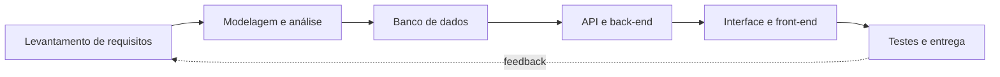

<!-- ============================================================
  README de perfil | Gelson Jose Kito
  1. Atualiza os links de contacto no fim do arquivo
  2. Mantem a pasta assets/ no repositorio (graficos e animacoes)
  ============================================================ -->

 

 

<table>
<tr>
<td width="62%" valign="top">

Sou o **Gelson José Kito**, tenho **19 anos** e vivo em **Luanda, Angola**.
Estudo **Análise de Sistemas** no **IPPK** e dedico o meu tempo a transformar ideias em aplicações que funcionam de ponta a ponta: do banco de dados à interface.

Gosto de entender bem o problema antes de escrever a primeira linha de código. Para mim, um bom sistema é aquele que as pessoas conseguem usar sem precisar de manual.

**Neste momento estou a:**

- aprofundar modelagem e análise de sistemas
- construir APIs REST com Node.js, Express e Sequelize
- explorar aplicações desktop com Electron
- procurar estágios e projetos colaborativos

</td>
<td width="38%" valign="top">

| | |
|:--|:--|
| **Nome** | Gelson José Kito |
| **Idade** | 19 anos |
| **Local** | Luanda, Angola |
| **Instituição** | IPPK |
| **Curso** | Análise de Sistemas |
| **Foco** | Full Stack |
| **Idioma** | Português |

</td>
</tr>
</table>

 

 
 
 

 
 

 
 

 

 

 

 

 

 

- [x] Dominar a base de HTML, CSS e JavaScript
- [x] Criar APIs REST com Node.js e Express
- [x] Trabalhar com bancos relacionais e não relacionais
- [x] Ficar confortável com TypeScript em projetos maiores
- [x] Publicar um sistema completo em produção
- [x] Contribuir para um projeto open source
- [ ] Concluir Análise de Sistemas

 

<!--  -->

<!--  -->

<!--  -->

  

